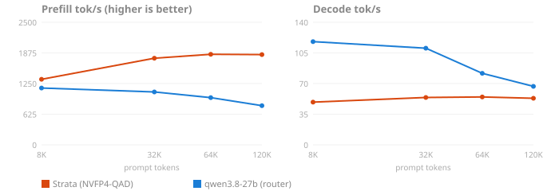

# Context ladder: Strata vs the 27B (ST-1)

What it tries: send the same questions with real source code as padding at 8K, 32K, 64K and 120K prompt
tokens and time each request from the SSE stream: time to first token (prefill tok/s) and decode tok/s. One arm is
Strata, the other the router's dense `qwen3.8-27b`. Each rung asks three questions once each, and one of them
(`layer-tracing-channel`) twice more, so there are three runs of the same question per rung and five requests in
all. Each answer is graded, so a fast wrong answer would not count.

## Verdict

**Strata pays off from about 32K tokens of prompt, and the gap grows with length: its prefill rises to ~1,840
tok/s and stays flat from 64K to 120K, while the 27B's falls from ~1,160 to ~800. Time to first token is 1.15x
faster at 8K, 1.6x at 32K, 1.9x at 64K and 2.3x at 120K (67 s against 154 s). The 27B decodes faster, though
(~110–120 tok/s up to 32K, ~67 at 120K, against Strata's flat ~49–55), so at 8K Strata is 5% slower in total, and
every long answer eats into its lead: Strata stays ahead while the reply is under ~1.25K tokens at 32K, ~5K at 64K
and ~23K at 120K.** All 40 answers were right on both arms (20 each); the two questions whose answer is only in the needle file
were right at every length on both, so neither traded accuracy for speed (see "Accuracy" below). Use Strata for long-prompt, short-answer work (whole-repo questions, reading big logs or documents); keep
the 27B for short prompts and long generations.

**Note on the Strata arm:** the brief names Strata IQ2_XS, but `strata.service` on this box now serves the
`qwen3.8-flash-next-fp4-local` NVFP4-QAD pack (Strata 0.2.7, MTP speculation, `--kv int8`), and no IQ2_XS pack
is left under `/models/strata-packs/`. That is what was measured. Its decode (~50 tok/s) is well below the
IQ2_XS reference (~90 tok/s), and its prefill at 64K (1.85K) below IQ2_XS's ~2.4K at 37K; the 27B lines up with
its references (~1K prefill, ~89 decode).

## Results

Run 2026-10-29: the three questions 16:36–16:57 EET (27B, then Strata in one ~7-minute window), the two repeat
runs 17:11–17:44 (27B, waiting for the shared router at times, then Strata in one ~5-minute window), back to the router after each Strata window. The
switches were made by this task's agent, which runs on Claude Code (not served by this box), as the brief asks.
The big table is the median of all five requests per rung; the last table is the same question run to run.

| rung | arm | right | prompt tokens | TTFT s, median (range) | prefill tok/s | decode tok/s, median (range) | output tokens | total s |
|---|---|---|---|---|---|---|---|---|
| 8K | Strata (NVFP4-QAD) | 5/5 | 8213 | 6.142 (6.047–6.621) | **1337** | **48.8** (43.1–60.4) | 97 | 8.361 |
| 8K | qwen3.8-27b (router) | 5/5 | 8173 | 7.051 (7.026–7.393) | **1159** | **117.9** (92.7–123) | 81 | 7.933 |
| 32K | Strata (NVFP4-QAD) | 5/5 | 32792 | 18.557 (18.462–18.588) | **1767** | **54.1** (50.3–54.9) | 106 | 20.391 |
| 32K | qwen3.8-27b (router) | 5/5 | 32754 | 30.362 (30.214–30.772) | **1079** | **110.4** (86.7–122.9) | 86 | 31.311 |
| 64K | Strata (NVFP4-QAD) | 5/5 | 65558 | 35.495 (35.402–35.691) | **1847** | **54.7** (46.5–60.3) | 82 | 36.91 |
| 64K | qwen3.8-27b (router) | 5/5 | 65522 | 68.067 (67.793–68.385) | **963** | **81.7** (67.5–91.9) | 87 | 69.325 |
| 120K | Strata (NVFP4-QAD) | 5/5 | 122900 | 66.745 (66.408–67.799) | **1841** | **53.2** (43.4–59.9) | 65 | 67.883 |
| 120K | qwen3.8-27b (router) | 5/5 | 122863 | 153.68 (153.229–161.537) | **799** | **66.8** (58.3–68.3) | 82 | 156.263 |

| rung | TTFT speed-up (27B ÷ Strata) | total speed-up |
|---|---|---|
| 8K | 1.15x | 0.95x |
| 32K | 1.64x | 1.54x |
| 64K | 1.92x | 1.88x |
| 120K | 2.30x | 2.30x |

Same question, run to run (`layer-tracing-channel`):

| rung | arm | runs | right | TTFT s (range) | prefill tok/s (range) | decode tok/s (range) |
|---|---|---|---|---|---|---|
| 8K | Strata (NVFP4-QAD) | 3 | 3/3 | 6.047–6.621 | 1241–1358 | 43.1–60.4 |
| 8K | qwen3.8-27b (router) | 3 | 3/3 | 7.026–7.393 | 1106–1163 | 92.7–118.6 |
| 32K | Strata (NVFP4-QAD) | 3 | 3/3 | 18.462–18.588 | 1764–1776 | 52.9–54.9 |
| 32K | qwen3.8-27b (router) | 3 | 3/3 | 30.214–30.772 | 1064–1084 | 86.7–122.9 |
| 64K | Strata (NVFP4-QAD) | 3 | 3/3 | 35.402–35.495 | 1847–1852 | 49.5–60.3 |
| 64K | qwen3.8-27b (router) | 3 | 3/3 | 67.793–68.067 | 963–966 | 67.5–81.7 |
| 120K | Strata (NVFP4-QAD) | 3 | 3/3 | 66.408–66.766 | 1841–1851 | 43.4–59.9 |
| 120K | qwen3.8-27b (router) | 3 | 3/3 | 153.581–161.537 | 761–800 | 58.3–66.8 |



- **Accuracy:** `route-head-fallback` and `package-mocha` are clean needles: their answer occurs only in the
  needle file at every rung. `layer-tracing-channel` is not, from 32K up: its answer, `express.router.request`,
  is also quoted in router/README.md (in the 32K–120K filler) and router/test/tracing.js (120K), so its 32K–120K
  rows show the model found the string, not that it found it in the needle. Its timings are as good as any.
  `build.ts` leaves out only the needle files; leaving out every file that holds an answer is the fix for a rerun.
- **Where the 27B stops:** it doesn't, within this ladder. Its preset has `ctx-size = 131072`, so 120K
  (122,880) plus the 4,096 `max_tokens` fits; the next power-of-two rung (128K + output) would not. Strata's
  `--max-context` is 262,144.
- **Run to run** the prefill is steady from 32K up: TTFT varies by under 1% on Strata and under 2% on the 27B,
  except one 27B 120K run at 161.5 s (5% slow by the client clock, see below). At 8K, where a request takes 6–7 s,
  it varies 9.5% on Strata and 5% on the 27B. Decode swings far more (Strata 43–60, the 27B 58–123).
- **Break-even reply length** (an extrapolation: decode measured on ~100-token replies, assumed flat for longer ones) (where the 27B's faster decode wins back Strata's prefill lead): TTFT saved ÷
  (1/Strata decode − 1/27B decode), medians from the table: 32K 11.8 s ÷ 0.0094 s ≈ 1.25K tokens, 64K 32.6 s ÷
  0.0060 s ≈ 5.4K, 120K 86.9 s ÷ 0.0038 s ≈ 22.7K. At 8K Strata falls behind after ~75 output tokens. Since
  decode is the noisy number, these are rough: read them as "about 1K, 5K, 20K".
- **Decode numbers are from short replies** (51–243 tokens, thinking included), so they carry more noise than
  the prefill numbers; the 27B's also swing with its DFlash2 + n-gram speculation, which drafts well on code-like
  text.
- **Sharing the router:** another task (NH-2) used the router during the repeat runs. `run.ts` waits until
  `/slots` shows the 27B's single slot idle before each request, and keeps llama.cpp's own `timings`. On the first
  round the client's prefill rate matched the server's within 1.4% on every request. In the repeats, three of eight
  27B requests were 3.7–4.5% slower by the client clock than by the server's (8K runs 2 and 3, 120K run 3): the
  other task's request got in between the check and the send. The server's own prefill rate for those (1158–1171
  and 797 tok/s) matches the rest. Strata, with nobody else on it, matched within 0.8%.
- **Cold every time:** a fresh `[request <uuid>]` opens every user message, so no prefix cache helps
  (llama.cpp `cache_n` is 0 or 51 on the 27B rows: at most the system prompt came from cache).
- **Memory:** MemAvailable stayed at or above 18.4 GiB with Strata up (the rows' before/after readings; the 5 s
  log of the first window saw 18.2 GiB). Floor 8 GiB. The VMs and the embedding container were not touched.

## The setup

- **Padding** (`target.json`, `scripts/fetch.sh`): real files from two MIT repos, [pillarjs/router](https://github.com/pillarjs/router)
  (TST-1's corpus, same commit) and [koajs/koa](https://github.com/koajs/koa) (router alone is ~100K tokens, too
  few for 120K), each file between `===== FILE <repo>/<path> =====` and `===== END … =====`, in `git ls-files`
  order, router first. Lock files and images are left out.
- **Questions** (`questions.json`): three of TST-1's questions on small router files (`lib/layer.js`,
  `lib/route.js`, `package.json`), with the path made explicit since two repos are in the prompt. Graded by regex
  on the `ANSWER:` line; a reply without one is wrong.
- **Prompts** (`scripts/build.ts`): for each rung and question, filler lines up to the rung (the last filler
  file cut at a line), the question's file put in at the file boundary nearest the middle (48–61% of the prompt),
  sized by the 27B's `/tokenize` to land 65–76 tokens under the rung by that count (the served prompts, with the nonce and
  chat template, come out within ~30 tokens of the rung: the 27B's a little under, Strata's a little over). Built once and sent unchanged to both arms;
  each arm's tokenizer counts them within 50 tokens of each other.
- **Requests** (`scripts/run.ts`): `/v1/chat/completions`, streamed, `chat_template_kwargs.enable_thinking:
  true` on **both arms**, server-default sampling, `max_tokens` 4096. A tiny warm-up request first. TTFT =
  request sent to the first streamed delta (thinking or answer); prefill tok/s = prompt tokens ÷ TTFT; decode
  tok/s = (completion tokens − 1) ÷ (last delta − first delta). No agent is involved, so no pi.

## How to run

```sh
scripts/fetch.sh                                   # clone the padding repos into work/ (needs jq)
export ROUTER_BASE_URL=http://<host>:18080/v1
local-ai-mode status && local-ai-mode router
node scripts/build.ts                              # work/prompts/<rung>/<question>.json
node scripts/run.ts --arm 27b                      # results/27b.jsonl
local-ai-mode strata
export STRATA_BASE_URL=http://<host>:18097/v1 STRATA_API_KEY=<key>
node scripts/run.ts --arm strata                   # results/strata.jsonl
local-ai-mode router                               # always end on the router
node scripts/report.ts                             # results/summary.md and results/ladder.svg
```

`run.ts` resumes: rows already in `results/<arm>.jsonl` are skipped (`--force` reruns them, `--rungs 8K,32K`
picks rungs). Never switch modes from inside an agent that Strata or the router is serving, and check that no other task is
using the router first (`local-ai-mode status`, its `/slots`): a Strata window stops the router for everyone.
